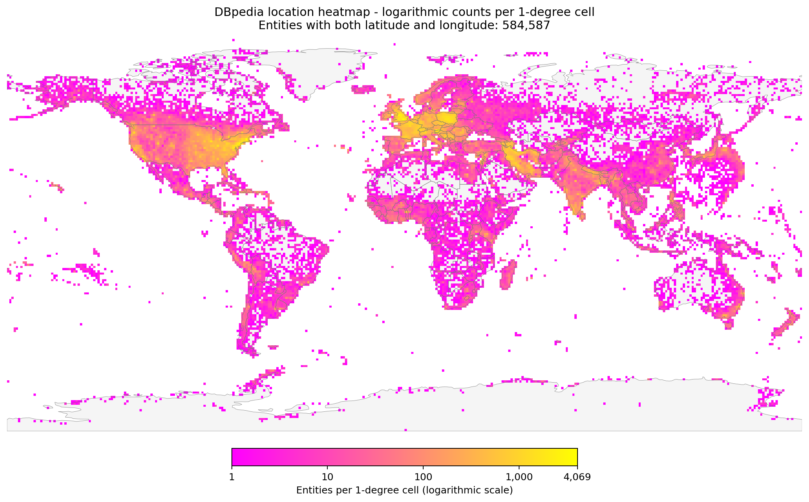
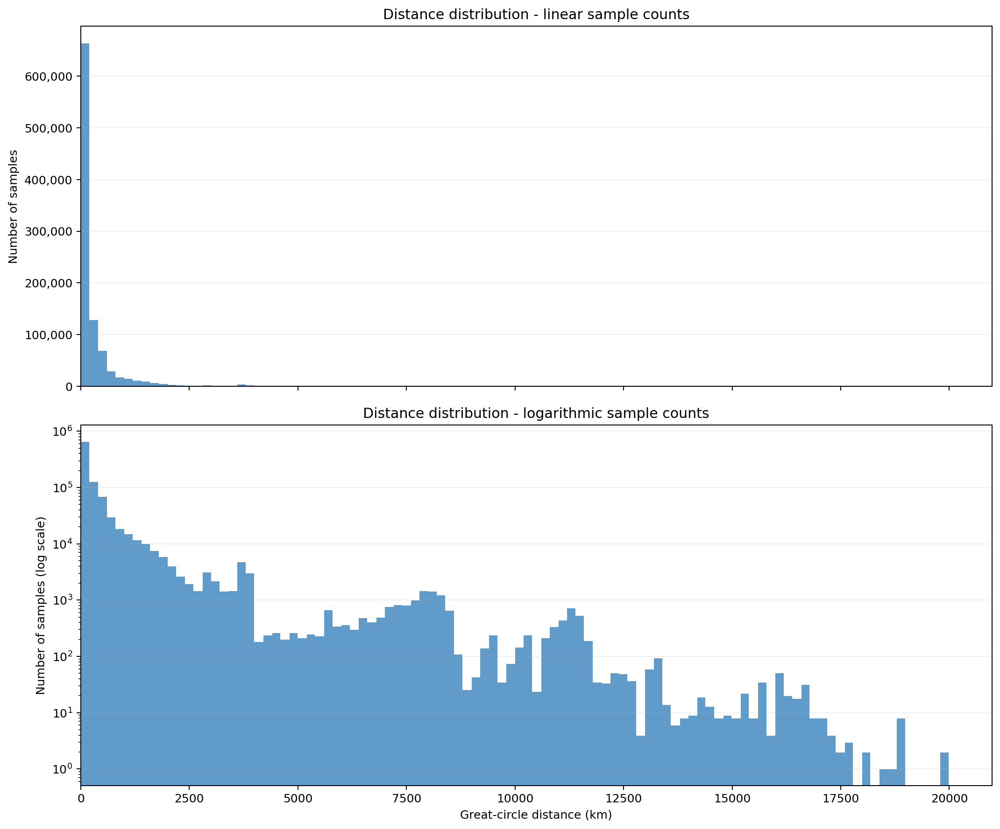

# DBpedia geographic data: EDA report

Maksymilian Norkiewicz (160267) and Kanstantsin Laurysiuk (161181)

## Dataset and filtering

Dataset: DBpedia 2016-04, English files. Download URL: <https://downloads.dbpedia.org/2016-04/core-i18n/en/>.

The notebook analyzes six local Turtle files totaling 12.61 GB:

| Source file | Size (GB) |
| --- | --- |
| `instance_types_transitive_en.ttl` | 4.565 |
| `article_categories_en.ttl` | 3.452 |
| `mappingbased_objects_en.ttl` | 2.517 |
| `skos_categories_en.ttl` | 0.973 |
| `instance_types_en.ttl` | 0.756 |
| `geo_coordinates_mappingbased_en.ttl` | 0.347 |

Only entities with both latitude and longitude are retained. The first stored value for each coordinate predicate is used. General statement counts include outgoing statements from these entities; their objects do not need coordinates.

| Measure | Result |
| --- | --- |
| Entities with both coordinates | 584,587 |
| Outgoing source statements | 10,900,280 |
| Distinct predicates | 235 |
| Distinct type IRIs | 157 |
| Literal-object statements | 1,755,094 (16.10%) |
| Resource-object statements | 9,145,186 (83.90%) |

There are 18.65 outgoing source statements per retained entity on average. Counts include repeated statements across files.

## Most frequent attributes

| Predicate | Statements | Share (%) |
| --- | --- | --- |
| rdf:type | 5,222,175 | 47.91 |
| dcterms:subject | 1,448,370 | 13.29 |
| dbo:isPartOf | 700,815 | 6.43 |
| georss:point | 585,052 | 5.37 |
| geo:long | 585,023 | 5.37 |
| geo:lat | 585,019 | 5.37 |
| dbo:country | 431,134 | 3.96 |
| dbo:timeZone | 284,118 | 2.61 |
| dbo:type | 185,340 | 1.70 |
| dbo:location | 163,078 | 1.50 |
| foaf:homepage | 100,013 | 0.92 |
| dbo:city | 44,571 | 0.41 |
| dbo:locatedInArea | 35,256 | 0.32 |
| dbo:region | 34,753 | 0.32 |
| dbo:district | 32,139 | 0.29 |
| rdfs:seeAlso | 28,905 | 0.27 |
| dbo:department | 28,568 | 0.26 |
| dbo:architecturalStyle | 27,846 | 0.26 |
| dbo:owner | 19,933 | 0.18 |
| dbo:sisterStation | 17,056 | 0.16 |

`rdf:type` and `dcterms:subject` together account for 61.20% of statements. Classification and category membership therefore make up most of the recorded statements. Percentages describe statements, not the percentage of entities having an attribute. Multiple coordinate statements can refer to the same entity.

## Most frequent entity types

| Type | Distinct entities |
| --- | --- |
| geo:SpatialThing | 584,587 |
| owl:Thing | 567,814 |
| dbo:Place | 534,454 |
| schema:Place | 534,454 |
| dbo:Location | 534,454 |
| dbo:PopulatedPlace | 391,751 |
| wikidata:Q486972 | 391,751 |
| dbo:Settlement | 378,026 |
| dbo:Village | 122,339 |
| wikidata:Q532 | 122,339 |
| dbo:ArchitecturalStructure | 94,478 |
| dbo:Building | 49,389 |
| wikidata:Q41176 | 49,389 |
| dbo:Infrastructure | 39,178 |
| dbo:Town | 34,574 |
| wikidata:Q3957 | 34,574 |
| dbo:Organisation | 33,333 |
| schema:Organization | 33,333 |
| dul:SocialPerson | 33,333 |
| wikidata:Q43229 | 33,333 |

The ranking includes broad classes, inherited classes, and equivalent classifications from different vocabularies. A village can also be a settlement and a place. These counts overlap and must not be summed. `wikidata:` identifies Wikidata class IRIs; `dul:` identifies a DUL ontology class.

## Administrative areas, settlements, and human-made entities

| Type | Distinct entities |
| --- | --- |
| dbo:Country | 543 |
| dbo:City | 18,802 |
| dbo:Town | 34,574 |
| dbo:Village | 122,339 |
| dbo:Settlement | 378,026 |
| dbo:AdministrativeRegion | 8,521 |
| dbo:ArchitecturalStructure | 94,478 |
| dbo:Building | 49,389 |
| dbo:Infrastructure | 39,178 |
| dbo:Organisation | 33,333 |

Settlements account for 64.67% of retained entities. The distinct union of countries, settlements, and administrative regions contains 387,090 entities (66.22%), excluding entities explicitly typed as ecclesiastical regions. This subtotal excludes the added structure and organization rows. The 543 country-classified entities are DBpedia records and can include historical entities.

## Natural features

| Type | Distinct entities |
| --- | --- |
| dbo:NaturalPlace | 25,135 |
| dbo:Mountain | 13,753 |
| dbo:BodyOfWater | 10,535 |
| dbo:Lake | 9,547 |
| dbo:Island | 4,661 |
| dbo:Volcano | 765 |
| dbo:Valley | 79 |
| dbo:Sea | 32 |
| dbo:River | 22 |
| dbo:Stream | 22 |
| dbo:Bay | 8 |
| dbo:MountainRange | 2 |
| dbo:Cave | 1 |

Mountains and lakes are the most common specific natural types in this table. Natural places account for 4.30% of retained entities. Rows overlap: a lake may also be a body of water and a natural place. Small counts describe this coordinate-filtered dataset, not the global abundance of a feature.

## Categories with the most member entities

| Category | Located members | Direct subcategories |
| --- | --- | --- |
| Villages in the Czech Republic | 4,093 | 2 |
| Unincorporated communities in West Virginia | 2,863 | 1 |
| Mountains of the Alps | 2,555 | 10 |
| Unincorporated communities in California | 1,905 | 7 |
| Houses on the National Register of Historic Places in New York | 1,842 | 1 |
| Townships in Minnesota | 1,774 | 3 |
| Villages in Turkey | 1,673 | 0 |
| Unincorporated communities in Kentucky | 1,642 | 1 |
| Mountains of Switzerland | 1,476 | 5 |
| Unincorporated communities in Wisconsin | 1,439 | 2 |
| Mountains of Peru | 1,402 | 1 |
| Houses on the National Register of Historic Places in Virginia | 1,270 | 0 |
| Unincorporated communities in Indiana | 1,244 | 1 |
| Cities and towns in Lombardy | 1,234 | 35 |
| Unincorporated communities in Virginia | 1,176 | 7 |
| Cities and towns in Piedmont | 1,171 | 34 |
| Houses on the National Register of Historic Places in North Carolina | 1,150 | 0 |
| Towns in Wisconsin | 1,105 | 1 |
| Townships in Michigan | 1,103 | 4 |
| Cities in Iran | 1,066 | 6 |

Located members are distinct entities with both coordinates directly linked through `dcterms:subject`. Direct subcategories are immediate children linked through `skos:broader` in the full category graph. The ranking uses member entities, not child categories; membership is not expanded to ancestor categories.

The largest categories describe villages, communities, mountains, and historic houses in particular regions. Category membership and formal entity types describe different aspects of an entity.

## Geographic distribution

The map shows uneven coverage, with visible concentrations in Europe and parts of North America. It counts entities per 1-degree cell. Cells have different physical areas at different latitudes, so this is not a count per square kilometre or a population map. Country-level coverage shares were not calculated.

## Distance between linked entities

Great-circle distances are calculated for 1,005,722 unique unordered linked pairs from `mappingbased_objects_en.ttl`, requiring both coordinates at each endpoint. Repeated, reciprocal, and multiple-predicate connections between the same pair count once. Self-links are excluded; distinct entities at the same coordinates remain included.

| Statistic | Distance (km) |
| --- | --- |
| Minimum | 0.00 |
| First quartile (Q1, 25%) | 12.25 |
| Median (Q2, 50%) | 74.09 |
| Third quartile (Q3, 75%) | 328.27 |
| Maximum | 19,981.67 |
| Average (mean) | 428.54 |
| Standard deviation (population) | 1,202.30 |

Half of linked pairs are within 74.09 km, and three quarters are within 328.27 km. The middle half spans 12.25-328.27 km. The mean of 428.54 km exceeds the median, showing a long right tail. The standard deviation is calculated over all analyzed pairs.

Distances use stored representative points, including points for countries and regions. They are not travel distances or distances between boundaries. Findings apply to the coordinate-filtered subset of these files, not to all DBpedia entities.

Notebook: [DBpedia_EDA.ipynb](../DBpedia_EDA.ipynb).
