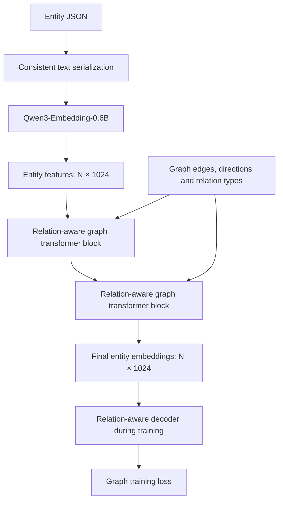

# Proposed entity embedding model

## Goal

Build an entity encoder that combines **entity attributes and knowledge graph structure**. Unlike RDF2Vec's vocabulary lookup, it should compute embeddings for previously unseen entities from their available text and, when present, graph neighbors.

The starting point is the GeoRDF2Vec paper and its accompanying repository. The proposed model is a new experimental architecture, not an implemented modification of that repository.

## Entity input

Represent each entity as JSON containing its available attributes. Convert the JSON into consistent text before passing it to a pretrained text encoder.

For example:

```json
{
  "name": "University of Warsaw",
  "type": "University",
  "city": "Warsaw",
  "country": "Poland"
}
```

Possible serialization:

```text
Name: University of Warsaw
Type: University
City: Warsaw
Country: Poland
```

The intention is to use the entity's available information, but field selection needs validation. Use consistent ordering and missing-value handling. Very long or irrelevant fields may need filtering or truncation. Do not include evaluation targets in the text. For link prediction, remove facts revealing held-out edges from both the text and message-passing graph.

## Proposed architecture

Use **one pretrained Qwen3-Embedding-0.6B encoder**, followed by a **small relation-aware graph transformer trained from scratch**.

Keep entity vectors at **1,024 dimensions throughout**. Do not reduce them to 256 dimensions.



Initially freeze Qwen and cache its entity vectors. Train the graph encoder and decoder on these features. Later, test limited Qwen fine-tuning if it improves results enough to justify the cost.

This is not a pipeline with two Qwen models. The graph transformer receives continuous entity vectors directly and uses graph edges to restrict attention.

## Graph transformer configuration

The proposed starting configuration is:

| Component | Configuration |
| --- | --- |
| Number of graph blocks | 2 |
| Entity input, hidden and output dimensions | 1,024 |
| Attention heads | 8, each with 128 dimensions |
| Attention neighborhood | Existing incoming graph edges in the supplied subgraph |
| Relation representation | Learned 1,024-dimensional embeddings |
| Edge direction | Separate relation IDs for original and inverse edges |
| Feed-forward network per block | 1,024 → 2,048 → 1,024 with GELU |
| Normalization | LayerNorm before attention and feed-forward operations |
| Regularization | Dropout, initially 0.1 |
| Residual connections | Around both attention and feed-forward operations |
| Candidate implementation | PyTorch and PyTorch Geometric `TransformerConv` |

Relation embeddings influence attention keys and message values. In the proposed `TransformerConv` implementation, the same projected edge feature contributes to both. Each block computes:

```text
x = x + Dropout(GraphAttention(LayerNorm(x), edges, relation_features))
x = x + Dropout(FeedForward(LayerNorm(x)))
```

The explicit residual replaces the convolution's built-in root transformation (`root_weight=False`). Two blocks allow information to propagate up to two graph hops within the supplied graph.

For example, inverse edges let the University of Warsaw receive messages from Warsaw through `inverse_city` and from Poland through `inverse_country`. Attention learns how strongly each message contributes under the training objective.

For large graphs, use sampled subgraphs rather than full-graph GPU training. Up to 16 neighbors per node per layer is an initial sampling candidate, not a validated requirement. Sampling must preserve relation labels, edge directions, and the intended two-hop dependencies.

## Training objective

The first proposed objective is **relation-aware link prediction**. A decoder scores a source entity, relation, and target entity:

```text
Positive: University_of_Warsaw → city → Warsaw
Corrupted candidate: University_of_Warsaw → city → another city
```

Use positive triples and sampled negatives to train the decoder and graph encoder. The decoder must distinguish edge direction. Its exact architecture, negative sampling strategy, and loss remain open implementation decisions.

Corrupted triples are not guaranteed to be false. Filter known positive triples from negative candidates and assess the effect of incomplete graph knowledge.

Initially, gradients stop at cached Qwen vectors. Joint fine-tuning requires recomputing Qwen outputs with gradients enabled so the graph loss can also update the text encoder. A separate loss for each encoder is not inherently required.

Link prediction is a proposed training task, not proof of usefulness for all downstream tasks. Evaluate the resulting vectors on the intended entity classification, similarity, or retrieval task as well.

## Previously unseen entities

The encoder should accept new entities without adding a new entity-specific trainable lookup vector:

- **Text and known neighbors available:** encode the text with Qwen and run the graph encoder on the accessible neighborhood.
- **Text only:** use the text feature path and explicitly test performance with no neighbors. Training with missing or dropped neighborhoods is a candidate strategy.
- **Opaque identifier only:** there is insufficient semantic or structural evidence for a meaningful embedding.

The initial graph encoder supports the relation vocabulary learned during training. Previously unseen relation types require a separate design; they are not automatically supported just because Qwen handles unseen entity text.

## Evaluation plan

Compare these systems using the same data splits and downstream evaluation:

1. Qwen text embeddings alone.
2. Frozen Qwen plus the proposed graph transformer.
3. Frozen Qwen plus a two-layer R-GCN baseline.
4. Qwen plus graph transformer with limited text-encoder fine-tuning.
5. RDF2Vec and GeoRDF2Vec as reference methods where applicable.

Use an **entity-disjoint split** to evaluate generalization to unseen entities. State whether test entities have observed neighbors and which edges are available at inference. For link prediction, exclude held-out edges and their inverses from encoder inputs. Also check that descriptions and other JSON fields do not reveal the targets.

Report multiple random seeds, prediction metrics, runtime, and memory usage. Compare graph models under matched feature dimensions and evaluation conditions. Establish whether graph training adds value beyond Qwen before increasing model depth or capacity.

## Data and scalability

The existing project contains a DBpedia 2016-04 English subset and KGBench `dmg777k` data. Start with a manageable subset rather than all of DBpedia. Labels and descriptions for Qwen may require additional data preparation: the current DBpedia preparation script discards most non-geographic literals.

For 10 million entities, cached 1,024-dimensional float32 vectors alone require about **40.96 GB** of storage. Model weights, edge data, activations, gradients, and optimizer state require additional memory. Keeping Qwen frozen allows its outputs to be generated in batches and stored outside GPU memory.

The graph transformer's weights are shared across entities. Its parameter count depends on architecture and the relation vocabulary, rather than allocating a learned entity embedding for every node. Feature storage and computation still grow with graph size.

## Geography and other open decisions

The first version combines text and graph structure. Explicit geographic encoding or geographic edge weighting can be added later as controlled experiments. Geographic proximity, structural similarity, and semantic similarity are distinct objectives and should not be assumed to coincide.

Remaining choices include JSON fields, serialization and token limits, decoder and loss, sampling strategy, final embedding normalization, fine-tuning method, and treatment of unseen relations. The architecture above is a starting hypothesis whose value must be demonstrated experimentally.

<!--
Proposed PyTorch architecture (source-only reference).
Requires torch and torch_geometric. This is an encoder prototype, not a
complete training pipeline. Qwen vectors are computed separately and initially
frozen. A decoder, loss, and neighborhood sampling are still required.

```python
import torch
from torch import nn
from torch_geometric.nn import TransformerConv


class GraphTransformerBlock(nn.Module):
    def __init__(self, dim=1024, heads=8, dropout=0.1):
        super().__init__()
        assert dim % heads == 0

        self.norm1 = nn.LayerNorm(dim)
        self.norm2 = nn.LayerNorm(dim)
        self.attention = TransformerConv(
            in_channels=dim,
            out_channels=dim // heads,
            heads=heads,
            concat=True,
            edge_dim=dim,
            dropout=dropout,
            root_weight=False,  # Use the explicit residual below.
        )
        self.ffn = nn.Sequential(
            nn.Linear(dim, 2048),
            nn.GELU(),
            nn.Dropout(dropout),
            nn.Linear(2048, dim),
        )
        self.dropout = nn.Dropout(dropout)

    def forward(self, x, edge_index, edge_features):
        update = self.attention(
            self.norm1(x), edge_index, edge_attr=edge_features
        )
        x = x + self.dropout(update)
        x = x + self.dropout(self.ffn(self.norm2(x)))
        return x


class EntityGraphEncoder(nn.Module):
    def __init__(self, num_relations, dim=1024, layers=2):
        super().__init__()
        self.num_relations = num_relations
        self.relation_embeddings = nn.Embedding(2 * num_relations, dim)
        self.blocks = nn.ModuleList([
            GraphTransformerBlock(dim=dim) for _ in range(layers)
        ])

    def forward(self, qwen_vectors, edge_index, edge_type):
        # qwen_vectors: float tensor [N, 1024].
        # edge_index: long tensor [2, E], source and target indices.
        # edge_type: long tensor [E], original relation IDs in [0, R).
        # Inputs must be on the same device as the model.
        # Supply original edges only; inverse edges are added here.
        edges = torch.cat([edge_index, edge_index.flip(0)], dim=1)
        relations = torch.cat([
            edge_type, edge_type + self.num_relations
        ])
        edge_features = self.relation_embeddings(relations)

        x = qwen_vectors
        for block in self.blocks:
            x = block(x, edges, edge_features)
        return x  # [N, 1024]


if __name__ == "__main__":
    # Node IDs: 0 = university, 1 = Warsaw, 2 = Poland.
    # Relation IDs: 0 = city, 1 = country.
    edge_index = torch.tensor([
        [0, 0, 1],
        [1, 2, 2],
    ], dtype=torch.long)
    edge_type = torch.tensor([0, 1, 1], dtype=torch.long)

    # Demonstration values only; replace with actual Qwen outputs.
    qwen_vectors = torch.randn(3, 1024)
    encoder = EntityGraphEncoder(num_relations=2)
    encoder.eval()
    with torch.no_grad():
        entity_vectors = encoder(qwen_vectors, edge_index, edge_type)
    print(entity_vectors.shape)  # torch.Size([3, 1024])
```
-->

## References

- [Qwen3-Embedding models and specifications](https://github.com/QwenLM/Qwen3-Embedding)
- [PyTorch Geometric TransformerConv](https://pytorch-geometric.readthedocs.io/en/latest/generated/torch_geometric.nn.conv.TransformerConv.html)
- [R-GCN: Modeling Relational Data with Graph Convolutional Networks](https://arxiv.org/abs/1703.06103)
- [GeoRDF2Vec paper](https://arxiv.org/abs/2504.17099)
- [GeoRDF2Vec repository](https://github.com/MartinBoeckling/GeoRDF2Vec)
